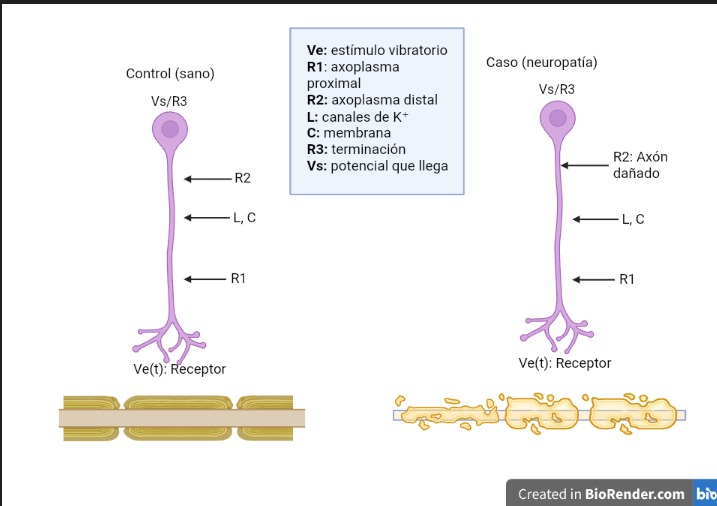

[](https://matlab.mathworks.com/open/github/v1?repo=LeonardoZaid/MSFPF)

# Proyecto final — Modelado y control del sistema nervioso y sensorial en neuropatía diabética periférica

Repositorio académico de la asignatura **Modelado de Sistemas Fisiológicos**, correspondiente al programa de **Ingeniería Biomédica** del Tecnológico Nacional de México / Instituto Tecnológico de Tijuana. El proyecto integra analogías eléctricas de sistemas fisiológicos, modelado matemático, análisis temporal y de estabilidad, simulación en MATLAB/Simulink y Python, y el diseño de un controlador PID, aplicados a un caso elegido por el equipo.

El caso de estudio representa de forma **fenomenológica** la conducción pasiva de un estímulo sensitivo de presión sostenida a lo largo de un axón periférico mediante un **circuito eléctrico de segundo orden** ($R_1$, $R_2$, $L$, $C$ y $R_3$). Se compara una condición de referencia (**control**, individuo sano) con una condición alterada (**caso**, neuropatía diabética periférica), en la que aumenta la resistencia axial distal $R_2$, y se diseña un controlador PID que acerque la respuesta del caso a la del control.

**Docente:** Dr. Paul Antonio Valle Trujillo  
**Correo:** paul.valle@tectijuana.edu.mx  
**Departamento:** Ingeniería Eléctrica y Electrónica  
**Institución:** Tecnológico Nacional de México / Instituto Tecnológico de Tijuana  
**Asignatura:** Modelado de Sistemas Fisiológicos  
**Programa:** Ingeniería Biomédica  
**Equipo:**

| Estudiante | Número de control | Correo institucional |
|---|---|---|
| Guerrero Peñaloza Josue Raúl | 24210583 | l24210583@tectijuana.edu.mx |
| Morales Díaz Ramón Iván | 24210589 | l24210589@tectijuana.edu.mx |
| Moreno Zavala Leonardo Zaid | 24210590 | l24210590@tectijuana.edu.mx |

**Repositorio del proyecto:** https://github.com/LeonardoZaid/MSFPF  
**Repositorio de la asignatura:** https://github.com/DrPaulValle/MSF-IBF1020  
**Sede:** Blvd. Alberto Limón Padilla s/n, Tijuana, C. P. 22454, B. C., México.

---

<a id="contenido"></a>
## Contenido

1. [Resumen](#resumen)
2. [Competencia y objetivos](#objetivos)
3. [Relación con el temario](#temario)
4. [Modelo fisiológico y analogía eléctrica](#analogia)
5. [Formulación matemática](#modelo)
6. [Análisis temporal y de estabilidad](#analisis)
7. [Condiciones de simulación y señales](#senales)
8. [Implementación en MATLAB y Simulink](#matlab)
9. [Control en lazo cerrado con PID](#pid)
10. [Reproducción en Python](#python)
11. [Laboratorio](#laboratorio)
12. [Resultados y verificación cruzada](#resultados)
13. [Actividades del estudiante](#actividades)
14. [Estructura del repositorio](#estructura)
15. [Requisitos](#requisitos)
16. [Reproducibilidad y entregables](#reproducibilidad)
17. [Cómo citar](#citar)
18. [Referencias](#referencias)

---

<a id="resumen"></a>
## Resumen

El proyecto modela la propagación pasiva de un estímulo sensitivo a lo largo de un axón con un circuito eléctrico en T. La fuente $V_e(t)$ alimenta el segmento proximal $R_1$; en el nodo intermedio la corriente se divide entre la rama $L$–$C$ a tierra (membrana) y el segmento distal $R_2$, que alimenta a la carga $R_3$ (terminación del nervio), donde se mide la salida $V_s(t)$. Por tener dos elementos independientes de almacenamiento de energía ($L$ y $C$), el sistema es de **segundo orden**.

Se formulan las **ecuaciones integro-diferenciales (EID)** por mallas con las leyes de Kirchhoff y se obtiene la función de transferencia $G(s)=V_s(s)/V_e(s)$. Control y caso comparten $R_1$, $R_3$, $L$ y $C$, y difieren únicamente en la resistencia axial distal: $R_2=330\,\Omega$ en el control y $R_2=2.2\,\mathrm{k}\Omega$ en el caso. La entrada es un **escalón de 1 V**, que representa un estímulo de presión sostenida como el del monofilamento de Semmes-Weinstein de 10 g. En estado estacionario el control entrega $0.74\,\mathrm{V}$ y el caso $0.31\,\mathrm{V}$: la neuropatía se manifiesta como **pérdida de amplitud**, no como un cambio de rapidez, porque ambos sistemas comparten polos casi iguales. Para corregir esa diferencia se diseña un **controlador PID con retroalimentación negativa** que toma la respuesta del control como referencia. Los resultados se obtienen con MATLAB/Simulink (modelo `sistema2020_5`), que implementa la planta en tres representaciones (EID, función de transferencia y circuito equivalente de Simscape Electrical), y se reproducen en Python.

El desarrollo completo de la analogía, la justificación de los parámetros y de la señal de entrada, y la interpretación de la salida están en [`ModeladoSistemaNerviosoSensorial.pdf`](ModeladoSistemaNerviosoSensorial.pdf).

**Palabras clave:** neuropatía diabética periférica; circuito RLC; controlador PID; conducción nerviosa; modelado de sistemas fisiológicos; MATLAB; Simulink; Simscape Electrical; simulación.

[Volver al contenido](#contenido)

---

<a id="objetivos"></a>
## Competencia y objetivos

### Competencia a desarrollar

Modelar sistemas fisiológicos mediante analogías eléctricas, ecuaciones diferenciales y funciones de transferencia para analizar su comportamiento dinámico y diseñar estrategias de control mediante técnicas de control clásico. En particular, el equipo selecciona un sistema fisiológico y una enfermedad, construye un circuito equivalente con valores diferenciados para el control y el caso, justifica la señal de entrada y la analogía, y diseña un controlador PID que reduzca la diferencia entre ambas respuestas.

### Objetivo general

Modelar, simular y controlar la conducción de un estímulo sensitivo en la neuropatía diabética periférica mediante un circuito eléctrico equivalente de segundo orden, y diseñar un controlador PID que reduzca la diferencia entre la respuesta del caso y la del control.

### Objetivos específicos

- Seleccionar el sistema fisiológico y la enfermedad, y construir el circuito con valores heurísticos distintos para el control y el caso.
- Justificar la señal de entrada y la analogía entre el circuito y el sistema fisiológico, distinguiendo individuo sano y enfermo.
- Formular las ecuaciones integro-diferenciales con las leyes de Kirchhoff y obtener $G(s)=V_s(s)/V_e(s)$ con la transformada de Laplace.
- Calcular el valor final, el error en estado estacionario y los polos de control y caso, y analizar el efecto de $R_2$.
- Simular ambas condiciones en Simulink con EID, función de transferencia y circuito equivalente (Simscape Electrical).
- Sintonizar un controlador PID con retroalimentación negativa que tome al control como referencia.
- Reproducir las respuestas en Python y documentar los resultados en un repositorio de GitHub.

[Volver al contenido](#contenido)

---

<a id="temario"></a>
## Relación con el temario

El proyecto integra contenidos de tres unidades de la asignatura **Modelado de Sistemas Fisiológicos (IBF-1020)**:

| Unidad | Área | Contenidos aplicados |
|---|---|---|
| I | Sistemas de control retroalimentados | Diagramas de bloques, señal de error, lazo abierto y cerrado, error en estado estacionario y estabilidad |
| II | Modelado matemático | Analogías eléctricas, leyes de Kirchhoff, ecuaciones integro-diferenciales y función de transferencia |
| III | Controladores | Diseño del PID y sintonización de ganancias |

[Volver al contenido](#contenido)

---

<a id="analogia"></a>
## Modelo fisiológico y analogía eléctrica

### Sistema fisiológico y enfermedad

El sistema somatosensorial periférico conduce la información de los receptores cutáneos hasta la médula espinal y el encéfalo. Los mecanorreceptores (discos de Merkel y corpúsculos de Ruffini, de Meissner y de Pacini) transforman el estímulo en un potencial receptor que origina potenciales de acción en fibras Aβ mielinizadas (tacto y presión); las fibras Aδ y C conducen dolor y temperatura. En los axones mielinizados el potencial de acción salta entre nodos de Ranvier, y la mielina disminuye la capacitancia y aumenta la resistencia de membrana [4].

La **neuropatía diabética periférica** es una polineuropatía simétrica distal, dependiente de la longitud del axón, secundaria a diabetes mellitus crónica [3, 6]. Sus principales alteraciones son:

- **Daño metabólico y oxidativo:** la hiperglucemia sostenida activa la vía de los polioles, genera productos de glicación avanzada y estrés oxidativo mitocondrial que dañan al axón y a las células de Schwann [1].
- **Isquemia microvascular:** la lesión de los *vasa nervorum* reduce la perfusión endoneurial.
- **Degeneración axonal y desmielinización segmentaria:** el adelgazamiento y la pérdida de axones disminuyen la velocidad de conducción y la amplitud del potencial sensitivo [2]. Clínicamente produce hormigueo, pérdida de sensibilidad en "guante y calcetín" y riesgo de pie diabético.

El circuito abstrae solo la propagación pasiva (electrotónica) y la atenuación de un estímulo de presión sostenida a lo largo de dos segmentos de axón, con la membrana como derivación a tierra y la terminación del nervio como carga.



*Esquema elaborado en BioRender: control (sano) y caso (neuropatía), con los elementos del circuito equivalente sobre el axón.*

### Correspondencias de la analogía

| Componente | Propiedad fisiológica | Justificación |
|---|---|---|
| $V_e(t)$ | Potencial receptor generado por el estímulo de presión | Aproximación funcional: tensión equivalente al potencial inducido en el terminal sensitivo |
| $R_1$, $R_2$ | Resistencia axial del axoplasma (segmento proximal y distal) | Biofísica fundamentada: $r_i=\rho_i/(\pi a^2)\propto 1/a^2$ [7] |
| $C$ | Capacitancia de membrana (bicapa y mielina) | Biofísica fundamentada: $C_m=dQ/dV_m$ |
| $L$ | Inductancia fenomenológica de los canales de K⁺ | Aproximación didáctica, a partir de la linealización del modelo de Hodgkin y Huxley [5]; solo interviene en el transitorio inicial |
| $R_3$ | Terminación del nervio (entrada a la siguiente neurona) | Aproximación funcional: resistencia de carga constante |
| $V_s(t)$, tierra | Potencial que llega al extremo del axón y medio extracelular | Computacional: medio extracelular equipotencial ideal |

### Topología del circuito equivalente

La fuente $V_e(t)$ y el resistor $R_1$ forman la rama principal. En el nodo posterior a $R_1$ se conecta a tierra la rama $L$–$C$ en serie (membrana), en paralelo con la rama formada por $R_2$ y $R_3$ en serie. La salida $V_s(t)$ es la tensión en $R_3$.

### Valores de los componentes

| Componente | Control | Caso |
|---|---:|---:|
| $R_1$ | 22 Ω | 22 Ω |
| $R_2$ | 330 Ω | 2.2 kΩ |
| $R_3$ | 1 kΩ | 1 kΩ |
| $L$ | 15 mH | 15 mH |
| $C$ | 470 µF | 470 µF |

Los valores se seleccionaron de forma **heurística** para que las salidas de control y caso se separen con claridad. Se conserva la topología y cambia solo $R_2$, lo que aísla el efecto de la atrofia axonal en el segmento más lejano al soma. Un aumento de $R_2$ de unas 6.7 veces equivale, por $r_i\propto 1/a^2$, a una reducción cercana a 61 % del diámetro axonal.

### Congruencia fisiopatológica y propuestas de ajuste

| Componente | Variación | Congruencia |
|---|---:|---|
| $R_1$ | 0 % | Neutra: segmento proximal conservado |
| $R_2$ | +567 % | Congruente: daño distal; equivale a ≈ 61 % menos de diámetro axonal |
| $R_3$ | 0 % | Parcial: omite el daño de la terminación |
| $L$ | 0 % | Neutra (didáctica): solo actúa en los primeros milisegundos |
| $C$ | 0 % | Parcial: omite el efecto de la desmielinización |

Un incremento de casi siete veces en $R_2$ es una atrofia distal severa, aceptable solo como caso avanzado. Como ajustes propuestos sin alterar la topología, se puede aumentar moderadamente $R_1$, $C$ y $R_3$ en el caso para representar además la desmielinización, el daño terminal y el enlentecimiento de la conducción.

> **Alcance de la analogía:** las correspondencias anteriores constituyen una analogía fenomenológica con fines académicos. Las unidades y los valores de los componentes eléctricos no representan mediciones fisiológicas ni validación clínica.

[Volver al contenido](#contenido)

---

<a id="modelo"></a>
## Formulación matemática

El desarrollo a mano está en el PDF [`AnalisisMatematicoProyecto.pdf`](AnalisisMatematicoProyecto.pdf) y se resume a continuación.

### 1. Ecuaciones integro-diferenciales (EID)

Con las corrientes de malla $I_1$ (malla de la fuente) e $I_2$ (malla de $R_2$–$R_3$), las leyes de Kirchhoff de voltaje dan:

$$
V_e(t)=R_1I_1+L\frac{d}{dt}(I_1-I_2)+\frac{1}{C}\int(I_1-I_2)\,dt,
$$

$$
0=(R_2+R_3)I_2+L\frac{d}{dt}(I_2-I_1)+\frac{1}{C}\int(I_2-I_1)\,dt,
\qquad V_s(t)=R_3I_2(t).
$$

Despejando las corrientes:

$$
I_1=\frac{1}{R_1}\left[V_e-L\frac{d}{dt}(I_1-I_2)-\frac{1}{C}\int(I_1-I_2)\,dt\right],
\qquad
I_2=\frac{1}{R_2+R_3}\left[-L\frac{d}{dt}(I_2-I_1)-\frac{1}{C}\int(I_2-I_1)\,dt\right].
$$

### 2. Función de transferencia

Con condiciones iniciales nulas, la impedancia de la rama $L$–$C$ es

$$
Z(s)=sL+\frac{1}{sC}=\frac{LCs^2+1}{sC}.
$$

Las ecuaciones de malla en el dominio de Laplace quedan

$$
V_e(s)=(R_1+Z)I_1-ZI_2,\qquad 0=-ZI_1+(R_2+R_3+Z)I_2 .
$$

Despejando $I_1$ de la segunda ecuación y sustituyendo en la primera:

$$
V_e(s)=\frac{R_1(R_2+R_3)+(R_1+R_2+R_3)Z}{Z}\,I_2,
\qquad V_s(s)=R_3I_2(s),
$$

de donde

$$
\frac{V_s(s)}{V_e(s)}=\frac{R_3Z}{R_1(R_2+R_3)+(R_1+R_2+R_3)Z}.
$$

Multiplicando numerador y denominador por $sC$:

$$
\boxed{G(s)=\frac{V_s(s)}{V_e(s)}=\frac{R_3\left(LC\,s^2+1\right)}{(R_1+R_2+R_3)LC\,s^2+R_1(R_2+R_3)C\,s+(R_1+R_2+R_3)}.}
$$

El denominador es de segundo grado porque el circuito tiene dos elementos independientes de almacenamiento de energía, $L$ y $C$. El numerador introduce un par de ceros imaginarios en $s=\pm j/\sqrt{LC}$. Dividiendo entre $R_1+R_2+R_3$ se obtiene la forma compacta que usa el documento del proyecto:

$$
G(s)=K\,\frac{1+s^2LC}{1+s\tau+s^2LC},\qquad K=\frac{R_3}{R_1+R_2+R_3},\qquad \tau=\left[R_1\parallel(R_2+R_3)\right]C.
$$

### 3. Funciones de transferencia de control y caso

Con $a=(R_1+R_2+R_3)LC$, $b=R_1(R_2+R_3)C$ y $c=R_1+R_2+R_3$, y con $R_3LC=7.05\times10^{-3}$:

$$
G_{control}(s)=\frac{7.05\times10^{-3}s^2+1000}{9.5316\times10^{-3}s^2+13.7522\,s+1352},
\qquad
G_{caso}(s)=\frac{7.05\times10^{-3}s^2+1000}{2.2715\times10^{-2}s^2+33.088\,s+3222}.
$$

[Volver al contenido](#contenido)

---

<a id="analisis"></a>
## Análisis temporal y de estabilidad

### 1. Valor final y error en estado estacionario

Ante un escalón unitario $V_e(s)=1/s$, el valor final es la ganancia en continua. Con la entrada ideal como referencia, el error por pérdida de señal es

$$
\lim_{t\to\infty}V_s(t)=G(0)=\frac{R_3}{R_1+R_2+R_3},\qquad
e_{ss}=1-G(0)=\frac{R_1+R_2}{R_1+R_2+R_3}.
$$

| Condición | $G(0)$ | $e_{ss}$ | Pérdida de señal | Corriente estacionaria de la fuente |
|---|---:|---:|---:|---:|
| Control ($R_2=330\,\Omega$) | 0.7396 | 0.2604 | 26.04 % | 0.74 mA |
| Caso ($R_2=2.2\,\mathrm{k}\Omega$) | 0.3104 | 0.6896 | 68.96 % | 0.31 mA |

La diferencia que el PID debe corregir en estado estacionario es $0.7396-0.3104\approx0.429$, es decir, cerca de **42.9 %** de la entrada (−2.6 dB en el control frente a −10.2 dB en el caso).

### 2. Polos, ceros y estabilidad

Los polos satisfacen $a\,s^2+b\,s+c=0$, con discriminante $b^2-4ac>0$ en ambos casos.

| Condición | Polos [s⁻¹] | Ceros [rad/s] | $\zeta$ | Comportamiento |
|---|---|---:|---:|---|
| Control | $-106.12$ y $-1336.68$ | $\pm j\,376.6$ | 1.92 | Estable, **sobreamortiguado** |
| Caso | $-104.94$ y $-1351.72$ | $\pm j\,376.6$ | 1.93 | Estable, **sobreamortiguado** |

Los cuatro polos son reales negativos, por lo que ambos sistemas son estables y no oscilan. La frecuencia natural $\omega_n=1/\sqrt{LC}\approx376.6\,\mathrm{rad/s}$ es la misma en ambos, porque no depende de $R_2$.

El polo dominante (≈ $-105\,\mathrm{s^{-1}}$) casi no cambia entre control y caso, así que **la neuropatía modelada reduce la amplitud pero no la rapidez**: $\tau=[R_1\parallel(R_2+R_3)]C\approx10\,\mathrm{ms}$ en ambos, porque $R_1$ es pequeña y domina el paralelo.

### 3. Respuesta al escalón del circuito completo

Con el numerador completo, $G(\infty)=G(0)=K$, por lo que la respuesta del circuito tiene tres etapas:

1. En $t=0$ la bobina actúa como circuito abierto y $V_s$ toma de inmediato el valor $K$.
2. La rama $L$–$C$ absorbe corriente mientras el capacitor se carga y $V_s$ cae a un mínimo cerca de 2 ms.
3. La salida se recupera exponencialmente hasta $K$, sin sobreimpulso sobre el valor final ni oscilaciones.

| Condición | Valor inicial | Mínimo (≈ 2 ms) | $t_{90}$ (90 %) | $t_s$ (2 %) | Valor final |
|---|---:|---:|---:|---:|---:|
| Control | 0.74 V | ≈ 0.10 V | ≈ 23 ms | ≈ 39 ms | 0.74 V |
| Caso | 0.31 V | ≈ 0.04 V | ≈ 23 ms | ≈ 39 ms | 0.31 V |

Los tiempos son prácticamente iguales en ambos: el modelo reproduce la pérdida de amplitud, pero no el enlentecimiento de la conducción.

### 4. Bosquejo previo

Antes de simular se elaboró un bosquejo cualitativo de la respuesta (hoja 7 de [`AnalisisMatematicoProyecto.pdf`](AnalisisMatematicoProyecto.pdf)), con un transitorio de unos 40 ms antes de llegar al estado estacionario.

[Volver al contenido](#contenido)

---

<a id="senales"></a>
## Condiciones de simulación y señales

### Selección de la señal de entrada

Se compararon cinco señales estándar. La senoidal caracteriza atenuación y desfase, pero prueba una sola frecuencia y oculta el transitorio. El pulso rectangular simula un contacto breve, pero la salida no alcanza su valor final. La rampa simula una presión progresiva, pero mezcla transitorio con error de seguimiento. La señal pseudoaleatoria identifica la respuesta en amplio espectro, pero carece de interpretación fisiológica directa. El escalón evalúa en una sola simulación el transitorio y la ganancia estacionaria; su limitación es que no informa sobre el desfase.

Se seleccionó, entonces,

$$
V_e(t)=A\,u(t),\qquad A=1\,\mathrm{V},
$$

aplicado en $t=0$ y simulado de 0 a 0.7 s. Representa un estímulo de presión sostenida que activa mecanorreceptores Aβ de adaptación lenta, como el que aplica el monofilamento de Semmes-Weinstein de 10 g, una de las pruebas clínicas con las que se detecta la neuropatía [6]. En la exploración clínica el monofilamento se presiona hasta doblarse y se mantiene entre 1 y 2 s, es decir, un escalón sostenido. Con $A=1\,\mathrm{V}$, $V_s$ indica directamente la fracción de señal que llega al extremo del nervio. La ventana de 0.7 s supera ampliamente el tiempo de establecimiento del modelo (≈ 39 ms); su escala de tiempo es didáctica y no corresponde a la cinética real del receptor.

### Parámetros de simulación

| Parámetro | MATLAB/Simulink | Python |
|---|---|---|
| Intervalo | $0\le t\le0.7\,\mathrm{s}$ (`StopTime = '0.7'`) | $0\le t\le0.7\,\mathrm{s}$ |
| Paso | `MaxStep = '1e-2'` s | $\Delta t=10^{-4}$ s (7001 puntos) |
| Método | `ode15s` | `control.forced_response` |
| Condiciones iniciales | Nulas | Nulas |
| Entrada | Escalón unitario (bloque `Step`, `Time = 0`) | `Ve = np.ones(n)` |

**Señales de salida:**

- $V_e(t)$: señal de entrada.
- $V_{sX}(t)$: salida del control (referencia).
- $V_{sY}(t)$: salida del caso, sin controlador.
- $PID(t)$: salida del caso con controlador (tratamiento).

**Señal de error:** para el diseño del control, la respuesta del control es la referencia del caso:

$$
e(t)=V_{sX}(t)-V_{sT}(t).
$$

[Volver al contenido](#contenido)

---

<a id="matlab"></a>
## Implementación en MATLAB y Simulink

El cuaderno MATLAB (*live script*) [`Guerrero_Morales_Moreno.mlx`](Guerrero_Morales_Moreno.mlx), con su exportación [`Guerrero_Morales_Moreno_Cuadernillo.pdf`](Guerrero_Morales_Moreno_Cuadernillo.pdf), abre el modelo `sistema2020_5`, lo simula con `StopTime` de 0.7 s, solver `ode15s` y `MaxStep` de 1e-2 s, y grafica los resultados con la función `plotsignals`:

```matlab
plotsignals(x.t, x.Ve, x.Vsy, x.Vsx, x.PID,'Caso')
```

La función `plotsignals(t,x1,x2,x3,x4,signal)` grafica $V_e(t)$, el caso, el control y el tratamiento con distintos estilos de línea, con ejes $0\le t\le0.7\,\mathrm{s}$ y $0\le V\le1.1\,\mathrm{V}$, leyenda en LaTeX, y exporta la figura en PDF vectorial con `exportgraphics`.

### Modelo de Simulink

El modelo contiene los subsistemas **Control** y **Caso**, y la planta se representa de tres formas para compararlas:

- **Ecuaciones integro-diferenciales (EID):** subsistemas `SysControlEID` y `SysCasoEID`, con integradores, derivadores y ganancias $1/C$, $1/L$, $1/R_1$, $1/(R_2+R_3)$ y $R_3$.
- **Función de transferencia (FT):** bloque de función de transferencia con $G(s)$ dentro de cada subsistema.
- **Circuito equivalente (CE):** componentes de Simscape Electrical (fuente de voltaje controlada, $R_1$, $L$, $C$, $R_2$, $R_3$, sensor de voltaje y referencia eléctrica); el `Subsystem2` agrupa circuitos equivalentes adicionales para comparar control y caso en un mismo osciloscopio.

El subsistema del caso incluye además el bloque **PID Controller** en un lazo con retroalimentación negativa (bloque de suma) cuya referencia es la salida del control. Las señales de entrada, control, caso, tratamiento y EID del caso se envían al *Workspace* (`Ve`, `Vsx`, `Vsy`, `PID`, `EIDC`) y a osciloscopios (*scopes*).

### Esquema general de control

1. El mismo estímulo $V_e(t)$ alimenta al **control** y al **caso**.
2. La salida del control es la **referencia** del lazo.
3. En el sumador se resta (retroalimentación negativa) la salida del caso con tratamiento.
4. El error pasa por el PID, que actúa sobre la planta del caso.
5. Las señales se comparan en el *scope* y en la figura de MATLAB.

[Volver al contenido](#contenido)

---

<a id="pid"></a>
## Control en lazo cerrado con PID

### 1. Retroalimentación negativa

La referencia es la salida del control, así que el error es

$$
e(t)=V_{sX}(t)-V_{sT}(t),
$$

donde $V_{sT}(t)$ es la salida del caso con tratamiento. Con $K(s)$ el controlador y $G_{caso}(s)$ la planta del caso, la función de transferencia de lazo cerrado es

$$
T(s)=\frac{K(s)\,G_{caso}(s)}{1+K(s)\,G_{caso}(s)}.
$$

### 2. Sintonización

El bloque `PID Controller` de Simulink está en forma paralela, tiempo continuo y con filtro en la acción derivativa:

$$
K(s)=k_P+\frac{k_I}{s}+k_D\frac{N\,s}{s+N}.
$$

| Parámetro | Valor |
|---|---:|
| $k_P$ | 34.7719 |
| $k_I$ | 7760.0917 |
| $k_D$ | 0.023147 |
| $N$ | 113 714.23 |

Estas ganancias están en el bloque `PID Controller` del subsistema Caso de `sistema2020_5` y se obtuvieron con la herramienta de sintonización de Simulink (*PID Tuner*, basada en función de transferencia). El script de Python usa las mismas ganancias.

### 3. Realización electrónica del PID

El script de Python calcula los componentes de un PID analógico con amplificador operacional, fijando $C_r=1\,\mu\mathrm{F}$:

$$
R_e=\frac{1}{C_r\,k_I},\qquad R_r=k_P\,R_e,\qquad C_e=\frac{k_D}{R_r},\qquad
K(s)=\frac{R_eR_rC_e\,s^2+(R_eC_e+R_rC_r)\,s+1}{R_eC_r\,s}.
$$

| Componente | Valor |
|---|---:|
| $C_r$ | 1 µF |
| $R_e$ | ≈ 128.86 Ω |
| $R_r$ | ≈ 4.48 kΩ |
| $C_e$ | ≈ 5.17 µF |

### 4. Desempeño en lazo cerrado

Verificación numérica con `numpy` y `control` a partir de la planta del caso tal como está en el bloque FT del modelo ($R_2=2.2\,\mathrm{k}\Omega$; ver [notas de verificación](#notas-verificacion)):

| Medida | Valor |
|---|---:|
| Polos de lazo cerrado | $-113\,507.6$, $-1551.6$, $-474.2$, $-465.2\ \mathrm{s^{-1}}$ (todos reales negativos) |
| Estabilidad de lazo cerrado | Estable |
| $T(0)$ | 1 (el integrador anula el error en estado estacionario) |
| Margen de fase | 83.6° @ 995 rad/s |
| Margen de ganancia | Infinito |
| Escalón unitario de referencia: sobreimpulso / pico / $t_s$ (2 %) | 7.08 % / 1.071 / ≈ 10 ms |
| Referencia = salida del control: pico del tratamiento | 0.7396 V (sin sobreimpulso respecto de la referencia) |
| Error máximo $\lvert e\rvert$ | ≈ 0.051 V (al inicio) |
| Tiempo para que $\lvert e\rvert$ sea menor que el 2 % de la referencia | ≈ 8.2 ms |
| Error final con tratamiento | Prácticamente cero |

Como el integrador da $T(0)=1$, el caso con tratamiento **sigue al control sin error en estado estacionario**, frente a la diferencia de cerca de 43 % que tiene el caso sin controlador. Como control y caso tienen casi la misma rapidez, el PID corrige principalmente la **amplitud** (la ganancia en continua), no la velocidad.

> **Alcance:** la estrategia de control tiene propósitos exclusivamente académicos y de simulación.

[Volver al contenido](#contenido)

---

<a id="python"></a>
## Reproducción en Python

El script [`Guerrero_Morales_Moreno.py`](Guerrero_Morales_Moreno.py) reproduce las respuestas de Simulink con `numpy`, `control` y `matplotlib`:

1. Define el intervalo $0\le t\le0.7\,\mathrm{s}$ con $\Delta t=10^{-4}$ s y el escalón unitario de entrada.
2. Calcula los componentes del PID analógico ($C_r$, $R_e$, $R_r$, $C_e$) y su función de transferencia.
3. Construye la planta con la función `G(R2)`, con el mismo numerador `[R3*L*C, R3]` y denominador `[(R1+R2+R3)*L*C, R1*(R2+R3)*C, R1+R2+R3]` de los bloques FT del modelo, y obtiene las plantas del control y del caso.
4. Forma el lazo cerrado `ctrl.feedback(ctrl.series(PID, caso), 1, sign=-1)` con el PID filtrado $k_P+k_I/s+k_DNs/(s+N)$, e imprime sus polos y su estabilidad.
5. Simula control, caso y tratamiento con `control.forced_response` (la referencia del lazo es la salida del control).
6. Grafica las cuatro señales con la función `plotsignals` (tipografía STIX, ejes $0$–$0.7$ s y $0$–$1.1$ V) y guarda la figura como `CasoTratamiento_python.pdf`.

Para ejecutarlo:

```bash
pip install numpy control matplotlib
python Guerrero_Morales_Moreno.py
```

[Volver al contenido](#contenido)

---

<a id="laboratorio"></a>
## Laboratorio

Esta entrega **no incluye montaje experimental**: el circuito se estudia por análisis y simulación. Los valores de los componentes son compatibles con valores comerciales (22 Ω, 330 Ω, 1 kΩ, 2.2 kΩ, 470 µF y un inductor de 15 mH), por lo que un montaje en protoboard con generador de funciones y osciloscopio sería viable como trabajo futuro.

**Resultados del equipo:** agregar, si se realiza, las fotografías de los montajes y las capturas del osciloscopio.

[Volver al contenido](#contenido)

---

<a id="resultados"></a>
## Resultados y verificación cruzada

### Archivos de resultados

| Figura | Herramienta | Contenido |
|---|---|---|
| [`Señales_matlab.pdf`](Se%C3%B1ales_matlab.pdf) | MATLAB/Simulink | $V_e(t)$, caso, control y tratamiento ante el escalón |
| [`CasoTratamiento_python.pdf`](CasoTratamiento_python.pdf) | Python | Figura que genera el script actual |
| [`Señales_python.pdf`](Se%C3%B1ales_python.pdf) | Python | Misma figura con otro estilo de línea para el tratamiento |
| [`ModeladoSistemaNerviosoSensorial.pdf`](ModeladoSistemaNerviosoSensorial.pdf) | Simulink (Simscape) | Respuesta del circuito equivalente de control y caso ante el escalón |

Los PDF se enlazan para su consulta porque GitHub no los presenta como imágenes incrustadas. En la figura de MATLAB el control se estabiliza en ≈ 0.74 V, el caso en ≈ 0.31 V y la curva del tratamiento queda superpuesta a la del control.

### Comparación de resultados

| Resultado | Análisis ($R_2=2.2\,\mathrm{k}\Omega$) | Simulink | Python (script actual) |
|---|---:|---:|---:|
| Control, valor final | 0.7396 V | ≈ 0.74 V | ≈ 0.74 V |
| Caso, valor final | 0.3104 V | ≈ 0.31 V | ≈ 0.23 V ($R_2=3.3\,\mathrm{k}\Omega$, ver nota 1) |
| Control, polos [s⁻¹] | −106.12 y −1336.68 | (mismos) | (mismos) |
| Caso, polos [s⁻¹] | −104.94 y −1351.72 | (mismos) | −104.72 y −1354.48 |
| Tratamiento, valor final | 0.7396 V | ≈ 0.74 V (sigue al control) | ≈ 0.74 V (sigue al control) |
| Tiempo de establecimiento (2 %) | ≈ 39 ms | ≈ 40 ms | ≈ 40 ms |

### Aspectos para discutir

- Cómo $R_2$ determina la **amplitud** que llega a la terminación ($V_s=R_3/(R_1+R_2+R_3)$), pero casi no cambia la rapidez de la respuesta, porque los polos permanecen cerca de $-105$ y $-1340\,\mathrm{s^{-1}}$.
- Efecto del PID: elimina el error en estado estacionario y hace que el caso siga al control, con un error transitorio máximo de pocos centésimos de volt.
- Qué representa clínicamente la pérdida de amplitud (el estímulo existe, pero la señal que llega al sistema nervioso central es mucho más débil) y qué no representa el modelo (enlentecimiento de la velocidad de conducción, porque control y caso se establecen prácticamente al mismo tiempo).
- Coincidencia entre las EID, la función de transferencia, el circuito equivalente y el análisis (ver nota 2).
- Limitaciones de la analogía fenomenológica (sección siguiente).

### Limitaciones del modelo

1. **Linealidad y pasividad:** el potencial de acción es regenerativo y no lineal [5]. El modelo solo representa propagación electrotónica, sin conducción saltatoria ni velocidad de conducción real.
2. **Parámetros concentrados:** dos segmentos y una derivación no capturan la distribución espacial (nodos de Ranvier, longitud axonal) ni fibras de distinto calibre; además, la derivación $L$–$C$ no incluye resistencia de fuga de membrana.
3. **Falta de especificidad y validación:** cualquier aumento de resistencia en serie atenúa $V_s$. Obtener curvas distintas demuestra sensibilidad paramétrica, pero no validación clínica; además se omiten el dolor neuropático y el daño de fibras finas.

### Conclusión

El modelo ilustra cualitativamente que el aumento de la resistencia axial distal ($R_2$: 330 Ω → 2.2 kΩ) reduce la señal que llega a la terminación del nervio de 0.74 a 0.31 V, reproduciendo conceptualmente la pérdida de sensibilidad de la neuropatía diabética y su carácter distal. Sin embargo, el tiempo de establecimiento (≈ 39 ms) no cambia, $L$ solo interviene en el transitorio inicial, la constancia de $R_3$ y $C$ omite el daño terminal y la desmielinización, y los valores están escalados, por lo que el alcance es exclusivamente didáctico.

<a id="notas-verificacion"></a>
### Notas de verificación

Puntos detectados al comparar los archivos entre sí; conviene resolverlos o justificarlos antes de la entrega final.

1. **$R_2$ del caso fuera del valor del proyecto.** El documento y los subsistemas Control/Caso de `sistema2020_5` (resistor de Simscape, FT y ganancia $1/(R_2+R_3)=1/3200$ de las EID) usan $R_2=2.2\,\mathrm{k}\Omega$. Siguen con $3.3\,\mathrm{k}\Omega$:
   - el script de Python (`caso = G(3300.0)`), por eso `CasoTratamiento_python.pdf` y `Señales_python.pdf` muestran el caso en ≈ 0.23 V. Basta cambiar esa línea a `G(2200.0)` y volver a ejecutar el script;
   - el resistor `R5` del `Subsystem2` (scope `Scope: Circuito`);
   - el desarrollo a mano (`AnalisisMatematicoProyecto.pdf`).

   Las ganancias del PID están sintonizadas sobre la planta de 2.2 kΩ. Con las mismas ganancias y $3.3\,\mathrm{k}\Omega$ el lazo cerrado también es estable (margen de fase ≈ 81°, sobreimpulso ante escalón unitario ≈ 8.3 %, $t_s\approx11.7\,\mathrm{ms}$).
2. **Numerador de los bloques de función de transferencia.** En el `.slx` y en el script de Python, el numerador de la FT es `[R3*L*C, R3]` = $7.05\times10^{-3}s+1000$ (primer orden), mientras que el desarrollo analítico da $R_3(LCs^2+1)$, es decir `[R3*L*C, 0, R3]`. Los polos y los valores finales son los mismos, pero la forma de la respuesta no: con el numerador del modelo la salida sube suavemente en ≈ 40 ms (como en el bosquejo y en las figuras de MATLAB y Python); con el numerador analítico, la salida salta de inmediato al valor final, cae a un mínimo cerca de 2 ms por el par de ceros en $\pm j376.6\,\mathrm{rad/s}$ y regresa al valor final, como en el circuito equivalente de Simscape. Las variables `Vsx`, `Vsy` y `PID` del *Workspace* salen de los bloques FT. Con el numerador analítico y las mismas ganancias del PID, el lazo cerrado calculado es estable pero menos amortiguado:

   | Planta del caso ($R_2=2.2\,\mathrm{k}\Omega$) | FT del modelo | FT analítica |
   |---|---:|---:|
   | Polos de lazo cerrado [s⁻¹] | $-113\,508$, $-1552$, $-474$, $-465$ | $-1193$, $-317$, $-56\pm j348$ |
   | Margen de fase | 83.6° | 69.0° |
   | Sobreimpulso (escalón unitario) | 7.08 % | 18.77 % |
   | $t_s$ (2 %) | ≈ 10 ms | ≈ 50 ms |

   Si se corrige el numerador, se recomienda resintonizar el PID.
3. **Hoja 5 de `AnalisisMatematicoProyecto.pdf`.** El valor del control está escrito como 0.7346 (73.46 %), pero $1000/1352=0.7396$ (73.96 %); el error de 26.04 % sí corresponde a 0.7396.
4. **Hojas 6 y 7 del desarrollo a mano.** Aparecen dos erratas de transcripción: $b=41.46$ en lugar de 44.46 para el caso, y $b=73.75$ en lugar de 13.75 al calcular el discriminante del control; los discriminantes resultantes y los polos son correctos. Además, en la hoja 1 la caligrafía de $L$ puede leerse como 75 mH, pero los cálculos y el modelo usan 15 mH.
5. **Nombre de la figura de MATLAB.** La función `plotsignals` guarda `Caso_matlab.pdf`; en esta entrega la figura aparece como `Señales_matlab.pdf`.
6. **Nombres de bloques.** Dentro del subsistema Caso, el bloque de FT llamado `Ve(t): Control` contiene en realidad la planta del caso (los dos bloques de FT de ese subsistema tienen los mismos parámetros). En el subsistema Control hay un bloque `Gain` de 0.25 sin conexión.
7. **Captura de sintonización.** No hay captura de la herramienta de sintonización del PID; las ganancias reportadas se leyeron directamente del bloque del modelo.

**Resultados del equipo:** agregar un comentario interpretativo propio sobre cada familia de respuestas y las conclusiones del proyecto.

[Volver al contenido](#contenido)

---

<a id="actividades"></a>
## Actividades del estudiante

### Etapa 1. Formulación y análisis

- [x] Seleccionar el sistema fisiológico y la enfermedad (sistema nervioso y sensorial; neuropatía diabética periférica).
- [x] Construir el circuito y diferenciar los valores del control y del caso.
- [x] Justificar la señal de entrada y la analogía con el sistema fisiológico (`ModeladoSistemaNerviosoSensorial.pdf`).
- [x] Formular las ecuaciones integro-diferenciales con las leyes de Kirchhoff.
- [x] Obtener $G(s)=V_s(s)/V_e(s)$ para control y caso.
- [x] Calcular el valor final, el error en estado estacionario y los polos, y determinar la estabilidad.
- [x] Elaborar el bosquejo cualitativo de las respuestas.

### Etapa 2. Simulación en lazo abierto

- [x] Implementar en Simulink las EID, la función de transferencia y el circuito equivalente (Simscape Electrical) de control y caso.
- [x] Definir la señal de entrada (escalón unitario) y simular de 0 a 0.7 s.
- [ ] Unificar $R_2=2.2\,\mathrm{k}\Omega$ en el script de Python, el `Subsystem2` y el desarrollo a mano (nota 1).
- [ ] Verificar que las tres representaciones coincidan (nota 2).

### Etapa 3. Diseño y comprobación del controlador

- [x] Construir el lazo cerrado con el control como referencia y el bloque `PID Controller`.
- [x] Sintonizar el PID y registrar $k_P$, $k_I$, $k_D$ y $N$.
- [ ] Agregar la captura de la sintonización y resintonizar si cambian la planta o el numerador de la FT.
- [x] Exportar el cuaderno MATLAB y la figura de resultados.
- [x] Reproducir las respuestas en Python con las mismas ganancias.

### Etapa 4. Documentación

- [ ] Agregar el comentario interpretativo propio y las conclusiones del equipo.
- [x] Crear el archivo `CITATION.cff`.
- [x] Agregar el enlace del repositorio en el encabezado.

[Volver al contenido](#contenido)

---

<a id="estructura"></a>
## Estructura del repositorio

```text
.
├── README.md                              # Reporte y guía de reproducción
├── CITATION.cff                           # Datos de citación
├── ModeladoSistemaNerviosoSensorial.pdf   # Documento del proyecto: metas, circuito, analogía, señal e interpretación
├── AnalisisMatematicoProyecto.pdf         # Desarrollo analítico a mano
├── sistema2020_5.slx                      # Modelo Simulink/Simscape
├── Guerrero_Morales_Moreno.mlx            # Cuaderno MATLAB
├── Guerrero_Morales_Moreno_Cuadernillo.pdf # Exportación del cuaderno MATLAB
├── Guerrero_Morales_Moreno.py             # Script de Python
├── Señales_matlab.pdf                     # Figura generada en MATLAB
├── CasoTratamiento_python.pdf             # Figura generada en Python
├── Señales_python.pdf                     # Figura generada en Python (variante)
└── Biorender.jpeg                         # Esquema del sistema (BioRender)
```

**Criterio de nombres:** los archivos conservan los nombres con que se generaron o entregaron. Si se renombra algún archivo, actualizar los enlaces de este README.

[Volver al contenido](#contenido)

---

<a id="requisitos"></a>
## Requisitos

### Software

- **MATLAB** y **Simulink**, con el modelo `sistema2020_5` y el cuaderno del proyecto.
- **Simscape Electrical**, para el circuito eléctrico equivalente del modelo.
- Herramientas de Simulink para la sintonización del bloque **PID Controller**.
- **Python 3** con `numpy`, `control` y `matplotlib`, para reproducir los resultados.
- **Git y GitHub** para presentar el repositorio.

[Volver al contenido](#contenido)

---

<a id="reproducibilidad"></a>
## Reproducibilidad y entregables

### Secuencia de reproducción

1. Clonar el [repositorio del proyecto](https://github.com/LeonardoZaid/MSFPF) y consultar el [repositorio general de la asignatura](https://github.com/DrPaulValle/MSF-IBF1020).
2. Revisar la topología del circuito y los valores de $R_1$, $R_2$, $R_3$, $L$ y $C$ de control y caso en `ModeladoSistemaNerviosoSensorial.pdf`.
3. Derivar las EID y la función de transferencia, y calcular valor final, error y polos.
4. Abrir el modelo `sistema2020_5` y ejecutar el cuaderno `Guerrero_Morales_Moreno.mlx`.
5. Revisar las ganancias del PID en el subsistema Caso y, si se modifica la planta, resintonizar.
6. Ejecutar `Guerrero_Morales_Moreno.py` y comparar su figura con la de MATLAB.
7. Exportar las figuras de resultados en PDF.

### Resultados mínimos esperados

| Entregable | Evidencia |
|---|---|
| Interpretación fisiológica | `ModeladoSistemaNerviosoSensorial.pdf` y sección [Modelo fisiológico y analogía eléctrica](#analogia) |
| Circuito eléctrico | Esquema del circuito equivalente de control y caso |
| Desarrollo matemático | EID, función de transferencia, error, polos y bosquejo (`AnalisisMatematicoProyecto.pdf`) |
| Funciones de transferencia | $G_{control}(s)$ y $G_{caso}(s)$ |
| Señal de entrada | Justificación del escalón en `ModeladoSistemaNerviosoSensorial.pdf` |
| MATLAB y Simulink | Cuaderno `.mlx` con su exportación `.pdf` y modelo `.slx` |
| Simscape Electrical | Circuitos equivalentes dentro del modelo `.slx` |
| Python | `Guerrero_Morales_Moreno.py` y su figura |
| Figuras | `Señales_matlab.pdf`, `CasoTratamiento_python.pdf`, `Señales_python.pdf` |
| Sintonización | Ganancias $k_P$, $k_I$, $k_D$, $N$ |
| Documentación | `README.md`, `CITATION.cff` e interpretación de los resultados |

### Criterios de presentación académica

Debe distinguirse entre **resultados de referencia reproducidos**, **mediciones o simulaciones propias** y **modificaciones realizadas por el equipo**. La ejecución de scripts y la generación de figuras no sustituyen la discusión del comportamiento fisiológico, matemático y eléctrico del sistema.

[Volver al contenido](#contenido)

---

<a id="citar"></a>
## Cómo citar

Los datos de citación están en [`CITATION.cff`](CITATION.cff):

> Guerrero Peñaloza, J. R., Morales Díaz, R. I., & Moreno Zavala, L. Z. (2026). *Proyecto final: Modelado y control del sistema nervioso y sensorial* (versión 1.0) [Software]. TecNM/ITT. https://github.com/LeonardoZaid/MSFPF

Licencia: BSD-2-Clause.

[Volver al contenido](#contenido)

---

<a id="referencias"></a>
## Referencias

[1] M. Brownlee, "Biochemistry and molecular cell biology of diabetic complications," *Nature*, vol. 414, no. 6865, pp. 813–820, 2001. https://doi.org/10.1038/414813a

[2] B. C. Callaghan, H. T. Cheng, C. L. Stables, A. L. Smith y E. L. Feldman, "Diabetic neuropathy: clinical manifestations and current treatments," *The Lancet Neurology*, vol. 11, no. 6, pp. 521–534, 2012. https://doi.org/10.1016/S1474-4422(12)70065-0

[3] E. L. Feldman *et al.*, "Diabetic neuropathy," *Nature Reviews Disease Primers*, vol. 5, art. 41, 2019. https://doi.org/10.1038/s41572-019-0092-1

[4] J. E. Hall y M. E. Hall, *Guyton and Hall Textbook of Medical Physiology*, 14th ed., Elsevier, 2021.

[5] A. L. Hodgkin y A. F. Huxley, "A quantitative description of membrane current and its application to conduction and excitation in nerve," *The Journal of Physiology*, vol. 117, no. 4, pp. 500–544, 1952. https://doi.org/10.1113/jphysiol.1952.sp004764

[6] R. Pop-Busui *et al.*, "Diabetic neuropathy: a position statement by the American Diabetes Association," *Diabetes Care*, vol. 40, no. 1, pp. 136–154, 2017. https://doi.org/10.2337/dc16-2042

[7] W. Rall, "Core conductor theory and cable properties of neurons," en *Handbook of Physiology, Sec. 1: The Nervous System, Vol. 1*, J. M. Brookhart y V. B. Mountcastle, Eds., American Physiological Society, 1977, pp. 39–97.

[8] K. Ogata, *Ingeniería de Control Moderna*, 5.ª ed., Pearson Educación, 2010.

[9] N. S. Nise, *Control Systems Engineering*, 8th ed., John Wiley & Sons, 2020.

[10] P. A. Valle, *Syllabus para Modelado de Sistemas Fisiológicos*, Tecnológico Nacional de México / Instituto Tecnológico de Tijuana, Tijuana, B. C., México, 2026. Disponible en: https://biomath.xyz/course/

[11] Tecnológico Nacional de México, *Programa de estudio de la asignatura Modelado de Sistemas Fisiológicos, IBF-1020*.

---

## Uso académico

Este repositorio se utiliza como evidencia del proyecto final de **Modelado de Sistemas Fisiológicos**. Su finalidad es desarrollar habilidades de modelado, análisis, simulación, diseño de control y documentación técnica; cualquier cambio de parámetros, estructura del controlador o procedimiento debe identificarse y justificarse. Los parámetros se seleccionaron heurísticamente y no constituyen mediciones fisiológicas ni validación clínica. La analogía eléctrica es fenomenológica y la estrategia de control tiene propósitos exclusivamente académicos y de simulación.
